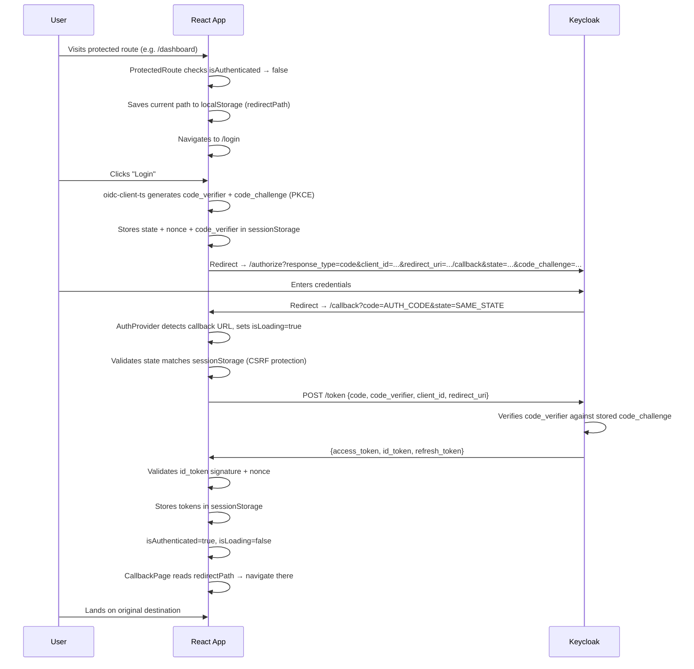
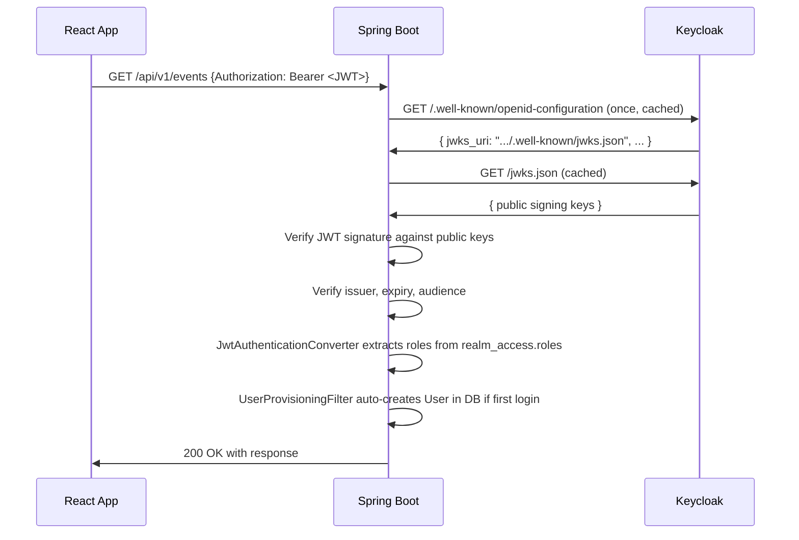

# Authentication & Authorization

This app uses **OpenID Connect (OIDC)** with **Keycloak** as the identity provider. The frontend is a public OIDC client (no client secret) using the **Authorization Code flow with PKCE**. The backend is a stateless **OAuth2 Resource Server** that validates JWTs.

---

## Components

| Component | Role |
|---|---|
| Keycloak (`:9090`) | Identity Provider — issues and signs JWTs |
| React frontend (`:5173`) | OIDC client — initiates login, holds tokens |
| Spring Boot backend (`:8080`) | Resource Server — validates tokens, enforces roles |
| `react-oidc-context` | React wrapper around `oidc-client-ts` |
| `oidc-client-ts` | Does the actual OIDC protocol work in the browser |

---

## Login Flow (Authorization Code + PKCE)

PKCE (Proof Key for Code Exchange) is required because this is a public client — there's no backend server to safely hold a client secret, so the browser proves it initiated the request using a cryptographic challenge instead.



### Why PKCE instead of a client secret?

A client secret must be kept private. In a browser app, any secret you ship is readable by anyone who opens DevTools. PKCE replaces it with a one-time cryptographic proof:

1. Before redirecting, the browser generates a random `code_verifier`
2. It hashes it → `code_challenge = BASE64URL(SHA256(code_verifier))`
3. The challenge goes to Keycloak in the authorization request
4. The verifier goes to Keycloak in the token request
5. Keycloak re-hashes the verifier and checks it matches — proving this token request came from the same party that started the login

An attacker who intercepts the `AUTH_CODE` in transit can't exchange it without the `code_verifier`, which never left the browser.

---

## Token Storage & Lifecycle

`oidc-client-ts` stores everything in **`sessionStorage`** (not localStorage):

```
sessionStorage:
  oidc.user:http://localhost:9090/realms/event-ticket-platform:event-ticket-platform-app
    → { access_token, id_token, refresh_token, expires_at, ... }
```

- **`access_token`** — short-lived JWT (typically 5 min). Sent with every API request as `Authorization: Bearer <token>`.
- **`id_token`** — JWT with user identity claims (`sub`, `email`, `preferred_username`). Used by the frontend to know who is logged in, not sent to the backend.
- **`refresh_token`** — longer-lived. Used to get new access tokens silently when the current one expires.
- **`sessionStorage` vs `localStorage`** — sessionStorage is cleared when the tab closes, which is why opening a new tab re-triggers authentication (no stored session to restore from the new tab's storage).

---

## Authenticated API Requests

Every protected API call passes the access token in the `Authorization` header:

```ts
// frontend/src/lib/api.ts
fetch("/api/v1/events", {
  headers: {
    Authorization: `Bearer ${accessToken}`,
  },
});
```

The `accessToken` comes from `useAuth()` in each component:

```ts
const { user } = useAuth();
const token = user?.access_token;
```

Public endpoints (browsing published events) skip the token entirely — no `Authorization` header sent.

---

## Backend JWT Validation



Spring Boot knows where to fetch Keycloak's public keys from one property:

```properties
spring.security.oauth2.resourceserver.jwt.issuer-uri=http://localhost:9090/realms/event-ticket-platform
```

From that URL, Spring fetches `/.well-known/openid-configuration`, which points to the JWKS endpoint. The public keys are cached — Keycloak is only contacted when keys rotate, not on every request. **The backend never contacts Keycloak to validate a token at request time.** JWT validation is pure cryptography, local to the backend process.

---

## Role-Based Authorization

Keycloak embeds roles inside the JWT under `realm_access.roles`:

```json
{
  "sub": "550e8400-e29b-41d4-a716-446655440000",
  "preferred_username": "dhev",
  "email": "dhev@example.com",
  "realm_access": {
    "roles": ["ROLE_ORGANIZER", "ROLE_STAFF"]
  }
}
```

`JwtAuthenticationConverter` reads this claim and maps each `ROLE_*` entry to a Spring `GrantedAuthority`. The security filter chain then enforces:

```java
.requestMatchers("/api/v1/events").hasRole("ORGANIZER")         // organizers only
.requestMatchers("/api/v1/ticket-validations").hasRole("STAFF") // staff only
.requestMatchers(GET, "/api/v1/published-events/**").permitAll() // public
.anyRequest().authenticated()                                    // everyone else must be logged in
```

---

## User Provisioning

The first time a Keycloak user hits any authenticated endpoint, `UserProvisioningFilter` runs after JWT validation and auto-creates a local `User` row in the database:

```java
UUID keycloakId = UUID.fromString(jwt.getSubject()); // JWT sub claim

if (!userRepository.existsById(keycloakId)) {
    User user = new User();
    user.setId(keycloakId);                                    // Keycloak UUID becomes the app user ID
    user.setName(jwt.getClaimAsString("preferred_username"));
    user.setEmail(jwt.getClaimAsString("email"));
    userRepository.save(user);
}
```

This is why `User.id` has no `@GeneratedValue` — the ID is the Keycloak subject UUID, not a DB-generated one. The two systems stay in sync by design.

---

## The Callback Page Bug (and Fix)

The original callback page had no fallback when `redirectPath` was missing from localStorage:

```ts
// before — if redirectPath is null, nothing happens, user stuck forever
const redirectPath = localStorage.getItem("redirectPath");
if (redirectPath) {
  localStorage.removeItem("redirectPath");
  navigate(redirectPath);
}

// after — always navigate somewhere
const redirectPath = localStorage.getItem("redirectPath") ?? "/dashboard";
localStorage.removeItem("redirectPath");
navigate(redirectPath);
```

`redirectPath` can be missing when:
- The user navigates directly to `/callback` manually
- localStorage was cleared between the redirect and the return
- The tab was refreshed mid-flow

The fix: default to `/dashboard` if nothing is stored.
